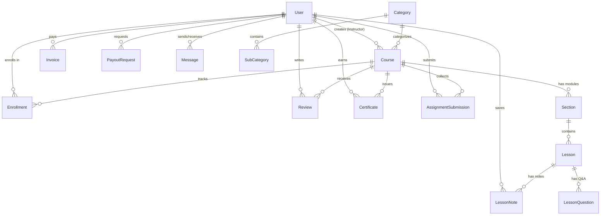

# Aibo8 LMS — Database Architecture & Schema Specification

**Platform:** Aibo8 — AI, Robotics & IoT Learning Management System  
**Database Engine:** PostgreSQL (Relational)  
**ORM / Schema Management:** Prisma ORM v6  
**Target Deployment:** AWS EC2 (Local PostgreSQL or AWS RDS)

---

## 1. Entity Relationship Diagram (Overview)

---

## 2. Database Enums

| Enum Name | Allowed Values | Purpose |
| :--- | :--- | :--- |
| `Role` | `STUDENT`, `INSTRUCTOR`, `ADMIN` | Role-based access control |
| `CourseStatus` | `DRAFT`, `PENDING`, `PUBLISHED` | Admin approval workflow |
| `LessonType` | `VIDEO`, `ARTICLE`, `CODE_LAB`, `QUIZ` | Lesson & timed objective exam types |
| `PaymentGateway` | `RAZORPAY`, `PHONEPE`, `FREE` | Active payment provider & receipts |
| `PayoutStatus` | `PENDING`, `PAID`, `REJECTED` | Instructor withdrawal lifecycle |
| `AssignmentStatus` | `SUBMITTED`, `GRADED` | Student project submission workflow |

---

## 3. Core Tables (Users, Courses & Learning)

### 3.1 `User`
Stores all Students, Instructors, and Administrators.

| Column | Type | Key / Constraint | Description |
| :--- | :--- | :--- | :--- |
| `id` | `VARCHAR` | Primary Key (`cuid`) | Unique user ID |
| `name` | `VARCHAR` | Not Null | Full display name |
| `email` | `VARCHAR` | Unique, Not Null | Login email address |
| `passwordHash` | `VARCHAR` | Not Null | Salted `bcryptjs` password hash |
| `role` | `Role` | Default `STUDENT` | `STUDENT`, `INSTRUCTOR`, or `ADMIN` |
| `avatar` | `VARCHAR` | Nullable | Profile avatar URL |
| `bio` | `TEXT` | Nullable | Instructor/student biography |
| `createdAt` | `TIMESTAMP` | Default `now()` | Account creation date |
| `updatedAt` | `TIMESTAMP` | Auto-updated | Last profile update |

### 3.2 `Category`
Top-level technology domains (e.g., AI & Edge ML, Robotics & ROS2, IoT & Embedded).

| Column | Type | Key / Constraint | Description |
| :--- | :--- | :--- | :--- |
| `id` | `VARCHAR` | Primary Key (`cuid`) | Unique category ID |
| `name` | `VARCHAR` | Not Null | Category display name |
| `slug` | `VARCHAR` | Unique, Not Null | URL-friendly identifier |
| `description` | `TEXT` | Nullable | Track summary |
| `icon` | `VARCHAR` | Nullable | Icon name |

### 3.3 `SubCategory`
Second-tier specializations nested under `Category` (e.g., ESP32 & Smart Wi-Fi/BLE, ROS2 & Autonomous SLAM).

| Column | Type | Key / Constraint | Description |
| :--- | :--- | :--- | :--- |
| `id` | `VARCHAR` | Primary Key (`cuid`) | Unique sub-category ID |
| `name` | `VARCHAR` | Not Null | Sub-category display name |
| `slug` | `VARCHAR` | Unique, Not Null | URL-friendly identifier |
| `categoryId` | `VARCHAR` | Foreign Key → `Category.id` | Parent category |

### 3.4 `Course`
Master catalog table for Free and Paid courses. All new courses default to `PENDING` until approved by Admin.

| Column | Type | Key / Constraint | Description |
| :--- | :--- | :--- | :--- |
| `id` | `VARCHAR` | Primary Key (`cuid`) | Unique course ID |
| `title` | `VARCHAR` | Not Null | Course title |
| `slug` | `VARCHAR` | Unique, Not Null | Course URL slug |
| `shortDescription` | `TEXT` | Not Null | Card summary |
| `description` | `TEXT` | Not Null | Detailed course overview |
| `thumbnail` | `VARCHAR` | Not Null | Intro/cover image URL (`/uploads/...` or external) |
| `introVideoUrl` | `VARCHAR` | Nullable | Promo/intro video URL (MP4 or YouTube/Vimeo) |
| `level` | `VARCHAR` | Default `"Beginner"` | Beginner / Intermediate / Advanced |
| `ageGroup` | `VARCHAR` | Nullable | Kids (8–12) / School (13–17) / College (18+) |
| `price` | `FLOAT` | Default `0` | Regular price in INR (₹) |
| `discountPrice` | `FLOAT` | Nullable | Optional discounted price in INR (₹) |
| `isFree` | `BOOLEAN` | Default `false` | Free vs Paid toggle |
| `duration` | `VARCHAR` | Default `"6h 30m"` | Estimated total length |
| `hardwareTags` | `VARCHAR[]` | Array | Hardware/tech tags (`ESP32`, `ROS2`, `Jetson`) |
| `outcomes` | `VARCHAR[]` | Array | Learning outcomes list |
| `requirements` | `VARCHAR[]` | Array | Hardware & prerequisites list |
| `status` | `CourseStatus` | Default `PENDING` | `PENDING`, `PUBLISHED`, or `DRAFT` |
| `featured` | `BOOLEAN` | Default `false` | Featured on homepage |
| `categoryId` | `VARCHAR` | Foreign Key → `Category.id` | Main category |
| `subCategoryId` | `VARCHAR` | Foreign Key → `SubCategory.id` | Sub-category |
| `instructorId` | `VARCHAR` | Foreign Key → `User.id` | Course author |
| `createdAt` / `updatedAt` | `TIMESTAMP` | Auto-managed | Timestamps |

### 3.5 `Section`
Ordered modules/chapters inside a course.

| Column | Type | Key / Constraint | Description |
| :--- | :--- | :--- | :--- |
| `id` | `VARCHAR` | Primary Key (`cuid`) | Unique section ID |
| `title` | `VARCHAR` | Not Null | Module title |
| `order` | `INT` | Default `0` | Display sort order |
| `courseId` | `VARCHAR` | Foreign Key → `Course.id` (Cascade) | Parent course |

### 3.6 `Lesson`
Individual Video lectures, Code Labs, Articles, or Timed Objective Exams inside a section.

| Column | Type | Key / Constraint | Description |
| :--- | :--- | :--- | :--- |
| `id` | `VARCHAR` | Primary Key (`cuid`) | Unique lesson ID |
| `title` | `VARCHAR` | Not Null | Lesson or exam title |
| `type` | `LessonType` | Default `VIDEO` | `VIDEO`, `ARTICLE`, `CODE_LAB`, `QUIZ` |
| `duration` | `VARCHAR` | Default `"10m"` | Duration string |
| `order` | `INT` | Default `0` | Sort order inside section |
| `isPreview` | `BOOLEAN` | Default `false` | Public free preview flag |
| `videoUrl` | `VARCHAR` | Nullable | Video embed or uploaded MP4 URL |
| `content` | `TEXT` | Nullable | Lesson brief / article content |
| `codeSnippet` | `TEXT` | Nullable | Copyable Python/C++/ROS2 code |
| `codeLang` | `VARCHAR` | Nullable | Syntax language (`python`, `cpp`, `bash`) |
| `quizData` | `JSONB` | Nullable | Array of MCQ questions, 4 options, `correctIndex`, `explanation` |
| `passingScore` | `INT` | Default `60` | Minimum % required to pass exam |
| `timeLimitMinutes` | `INT` | Default `10` | Countdown timer in minutes |
| `maxAttempts` | `INT` | Default `3` | Maximum allowed quiz attempts |
| `sectionId` | `VARCHAR` | Foreign Key → `Section.id` (Cascade) | Parent section |

### 3.7 `Enrollment`
Tracks student course access, lesson completion, quiz attempts/scores, and overall progress.

| Column | Type | Key / Constraint | Description |
| :--- | :--- | :--- | :--- |
| `id` | `VARCHAR` | Primary Key (`cuid`) | Unique enrollment ID |
| `userId` | `VARCHAR` | Foreign Key → `User.id` (Cascade) | Enrolled student |
| `courseId` | `VARCHAR` | Foreign Key → `Course.id` (Cascade) | Enrolled course |
| `completedLessons` | `VARCHAR[]` | Default `[]` | Array of completed `Lesson.id` values |
| `quizScores` | `JSONB` | Nullable | Per-quiz `{ score, total, percent, passed, attempts }` |
| `progress` | `INT` | Default `0` | Completion percentage (`0–100`) |
| `enrolledAt` | `TIMESTAMP` | Default `now()` | Enrollment date *(Unique: `userId + courseId`)* |

### 3.8 `Certificate`
Official verifiable completion diplomas auto-issued once progress is 100% and all objective exams are passed.

| Column | Type | Key / Constraint | Description |
| :--- | :--- | :--- | :--- |
| `id` | `VARCHAR` | Primary Key (`cuid`) | Unique certificate ID |
| `verifyCode` | `VARCHAR` | Unique, Not Null | Public verification code (e.g. `AIBO8-IOT-2026-9X4K`) |
| `userId` | `VARCHAR` | Foreign Key → `User.id` | Recipient student |
| `courseId` | `VARCHAR` | Foreign Key → `Course.id` | Completed course *(Unique: `userId + courseId`)* |
| `issuedAt` | `TIMESTAMP` | Default `now()` | Issue date |

---

## 4. Engagement, Community & Assessment Tables

### 4.1 `Review`
| Column | Type | Key / Constraint | Description |
| :--- | :--- | :--- | :--- |
| `id` | `VARCHAR` | Primary Key (`cuid`) | Review ID |
| `rating` | `INT` | Not Null (1–5) | Star rating |
| `comment` | `TEXT` | Not Null | Student feedback |
| `userId` | `VARCHAR` | Foreign Key → `User.id` | Reviewer |
| `courseId` | `VARCHAR` | Foreign Key → `Course.id` | Target course |
| `createdAt` | `TIMESTAMP` | Default `now()` | Timestamp |

### 4.2 `LessonNote`
| Column | Type | Key / Constraint | Description |
| :--- | :--- | :--- | :--- |
| `id` | `VARCHAR` | Primary Key (`cuid`) | Note ID |
| `content` | `TEXT` | Not Null | Personal lab/pinout note |
| `userId` | `VARCHAR` | Foreign Key → `User.id` | Owner student |
| `lessonId` | `VARCHAR` | Foreign Key → `Lesson.id` | Linked lesson |
| `createdAt` | `TIMESTAMP` | Default `now()` | Timestamp |

### 4.3 `LessonQuestion` (Per-Lesson Q&A)
| Column | Type | Key / Constraint | Description |
| :--- | :--- | :--- | :--- |
| `id` | `VARCHAR` | Primary Key (`cuid`) | Question ID |
| `lessonId` | `VARCHAR` | Foreign Key → `Lesson.id` | Linked lesson |
| `courseId` | `VARCHAR` | Foreign Key → `Course.id` | Linked course |
| `userId` | `VARCHAR` | Foreign Key → `User.id` | Asking student |
| `question` | `TEXT` | Not Null | Doubt/question body |
| `replies` | `JSONB` | Default `[]` | Array of mentor/student replies |
| `createdAt` | `TIMESTAMP` | Default `now()` | Timestamp |

### 4.4 `AssignmentSubmission` (Hardware & Code Projects)
| Column | Type | Key / Constraint | Description |
| :--- | :--- | :--- | :--- |
| `id` | `VARCHAR` | Primary Key (`cuid`) | Submission ID |
| `courseId` | `VARCHAR` | Foreign Key → `Course.id` | Linked course |
| `userId` | `VARCHAR` | Foreign Key → `User.id` | Submitting student |
| `projectTitle` | `VARCHAR` | Not Null | Project title |
| `repoUrl` | `VARCHAR` | Nullable | GitHub / Wokwi simulator URL |
| `schematicUrl` | `VARCHAR` | Nullable | Circuit diagram / hardware photo URL |
| `notes` | `TEXT` | Nullable | Student project explanation |
| `status` | `AssignmentStatus` | Default `SUBMITTED` | `SUBMITTED` or `GRADED` |
| `grade` | `INT` | Nullable (`0–100`) | Score assigned by instructor/admin |
| `feedback` | `TEXT` | Nullable | Instructor review notes |
| `submittedAt` | `TIMESTAMP` | Default `now()` | Submission timestamp |

### 4.5 `Message` (Student ↔ Instructor Inbox)
| Column | Type | Key / Constraint | Description |
| :--- | :--- | :--- | :--- |
| `id` | `VARCHAR` | Primary Key (`cuid`) | Message ID |
| `senderId` | `VARCHAR` | Foreign Key → `User.id` | Sender user |
| `receiverId` | `VARCHAR` | Foreign Key → `User.id` | Recipient user |
| `body` | `TEXT` | Not Null | Message text |
| `createdAt` | `TIMESTAMP` | Default `now()` | Timestamp |

### 4.6 `Wishlist`
| Column | Type | Key / Constraint | Description |
| :--- | :--- | :--- | :--- |
| `userId` | `VARCHAR` | Foreign Key → `User.id` | Student |
| `courseId` | `VARCHAR` | Foreign Key → `Course.id` | Saved course *(Unique: `userId + courseId`)* |

---

## 5. Commerce, Bundles, Invoices & Payouts Tables

### 5.1 `Bundle` (Multi-Course Value Packs)
| Column | Type | Key / Constraint | Description |
| :--- | :--- | :--- | :--- |
| `id` | `VARCHAR` | Primary Key (`cuid`) | Bundle ID |
| `title` | `VARCHAR` | Not Null | Bundle title |
| `slug` | `VARCHAR` | Unique | URL slug |
| `tagline` | `TEXT` | Not Null | Marketing subtitle |
| `ageGroup` | `VARCHAR` | Not Null | Target school/college stage |
| `courseIds` | `VARCHAR[]` | Array | Included `Course.id` list |
| `bundlePrice` | `FLOAT` | Not Null | Discounted bundle price (₹) |
| `regularTotal` | `FLOAT` | Not Null | Combined original price (₹) |
| `thumbnail` | `VARCHAR` | Not Null | Bundle banner image |

### 5.2 `Coupon`
| Column | Type | Key / Constraint | Description |
| :--- | :--- | :--- | :--- |
| `id` | `VARCHAR` | Primary Key (`cuid`) | Coupon ID |
| `code` | `VARCHAR` | Unique, Not Null | Promo code (e.g. `AIBO20`) |
| `discountPercent` | `INT` | Not Null | Percentage off (`5–100`) |
| `active` | `BOOLEAN` | Default `true` | Enabled flag |
| `expiresAt` | `TIMESTAMP` | Nullable | Optional expiry date |

### 5.3 `PaymentGatewaySettings` (Admin Singleton Configuration)
| Column | Type | Description |
| :--- | :--- | :--- |
| `activeGateway` | `PaymentGateway` | Single active frontend checkout method (`RAZORPAY` or `PHONEPE`) |
| `currency` / `currencySymbol` | `VARCHAR` | Default `INR` / `₹` |
| `adminCommissionPercent` | `INT` | Platform revenue share % (e.g. `20%` Admin / `80%` Instructor) |
| `razorpayConfig` | `JSONB` | `{ enabled, mode, keyId, keySecret }` |
| `phonepeConfig` | `JSONB` | `{ enabled, mode, merchantId, saltKey, saltIndex }` |

### 5.4 `Invoice` (Orders, GST & Revenue Split)
| Column | Type | Key / Constraint | Description |
| :--- | :--- | :--- | :--- |
| `id` | `VARCHAR` | Primary Key (`cuid`) | Invoice ID |
| `invoiceNumber` | `VARCHAR` | Unique | Formal receipt number (`AIBO8-2026-XXXX`) |
| `userId` | `VARCHAR` | Foreign Key → `User.id` | Buyer student |
| `itemType` | `VARCHAR` | Not Null | `COURSE` or `BUNDLE` |
| `itemId` | `VARCHAR` | Not Null | Purchased course or bundle ID |
| `itemTitle` | `VARCHAR` | Not Null | Snapshot of item title |
| `instructorId` | `VARCHAR` | Foreign Key → `User.id` | Credited instructor |
| `gateway` | `PaymentGateway` | Not Null | `RAZORPAY`, `PHONEPE`, or `FREE` |
| `transactionId` | `VARCHAR` | Not Null | Gateway payment/order reference |
| `subtotal` | `FLOAT` | Not Null | Base amount (₹) |
| `discount` | `FLOAT` | Default `0` | Coupon discount (₹) |
| `taxAmount` | `FLOAT` | Default `0` | GST 18% (₹) |
| `totalPaid` | `FLOAT` | Not Null | Final paid amount (₹) |
| `adminShare` | `FLOAT` | Not Null | Platform commission amount (₹) |
| `instructorShare` | `FLOAT` | Not Null | Instructor net earning (₹) |
| `createdAt` | `TIMESTAMP` | Default `now()` | Purchase timestamp |

### 5.5 `PayoutRequest` (Instructor Withdrawals)
| Column | Type | Key / Constraint | Description |
| :--- | :--- | :--- | :--- |
| `id` | `VARCHAR` | Primary Key (`cuid`) | Payout request ID |
| `instructorId` | `VARCHAR` | Foreign Key → `User.id` | Requesting instructor |
| `amount` | `FLOAT` | Not Null | Withdrawal amount (₹) |
| `method` | `VARCHAR` | Not Null | `UPI` or `Bank IMPS` |
| `accountDetails` | `VARCHAR` | Not Null | UPI ID or bank account |
| `status` | `PayoutStatus` | Default `PENDING` | `PENDING`, `PAID`, or `REJECTED` |
| `createdAt` | `TIMESTAMP` | Default `now()` | Request date |
| `paidAt` | `TIMESTAMP` | Nullable | Settlement timestamp |

---

## 6. Security & Integrity Highlights
* **Password Security:** All passwords are salted and hashed with `bcryptjs` (never stored in plain text).
* **Session Security:** HTTP-only signed HS256 JWT cookies via `jose`.
* **Data Integrity:** Composite unique constraints prevent duplicate enrollments (`userId + courseId`) and duplicate certificates (`userId + courseId`), with cascading deletes on course curriculum trees.
